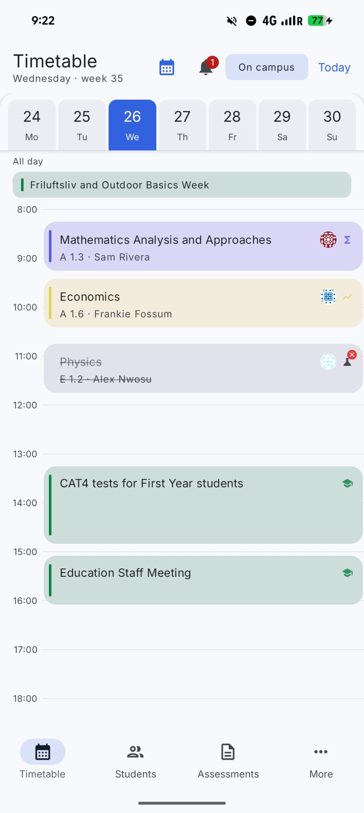
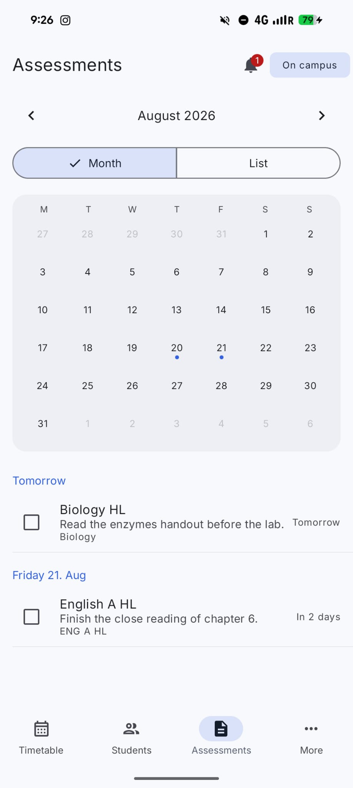
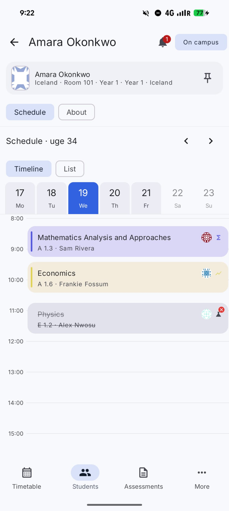

<p align="center">
  
</p>

<h1 align="center">BetterW4</h1>

<p align="center">
  A faster, friendlier way to use W4 on iPhone, Android, and the web.
</p>

BetterW4 is an unofficial client for [W4](https://w4.uwcrcn.no/), the student system at [UWC Red Cross Nordic](https://uwcrcn.no/). It takes the timetable, assessments, mail, attendance, directories, and campus tools that normally live in the W4 website and gives them a home that feels natural on your phone.

The mobile apps connect directly to W4. There is no BetterW4 account or proxy server in the middle. Your session, settings, and cached pages stay on your device.

BetterW4 is not made by, endorsed by, or affiliated with UWC Red Cross Nordic.

## A look at the app

<p align="center">
  
  &nbsp;
  
  &nbsp;
  
</p>

<p align="center"><sub>Android shown with demo data. No real student information is included.</sub></p>

## What you can do

- See academics and extra academics together in one timetable
- Add personal events that stay on your device
- Check assessments in a calendar or list
- Read mail and view attachments
- Find grades, absence records, and attendance information
- Browse student and staff directories, houses, and on-duty information
- Check notifications and update your campus status
- Keep recently viewed information available offline
- Try the app without an account by using the built-in demo mode
- Use light or dark mode and personalize subjects with names and colours

The iOS and Android apps are native, so they follow the navigation and interface conventions of each platform. The browser extension keeps the familiar W4 layout while giving it updated styling, dark mode, and a cleaner login experience.

## How it works

W4 does not provide a public API, so BetterW4 reads the same pages and submits the same forms as a browser. Login credentials and two-factor authentication codes are sent straight to `w4.uwcrcn.no`. Passwords are never saved by BetterW4.

Cached pages make the mobile apps useful with a weak connection or in airplane mode. Signing out removes the saved session and cached W4 data for that account. You can read the full [privacy policy](PRIVACY.md) or the technical [W4 protocol notes](PROTOCOL.md) for more detail.

## Projects in this repository

| Path | What is inside |
|---|---|
| [`ios/`](ios/) | The SwiftUI app for iPhone and iPad |
| [`android/`](android/) | The Kotlin and Jetpack Compose app for Android |
| [`extension/`](extension/) | The WXT and Preact browser extension for Chrome and Firefox |
| [`website/`](website/) | The Next.js project for the BetterW4 website |
| [`PROTOCOL.md`](PROTOCOL.md) | Notes about W4 login, cookies, routes, and page parsing |
| [`PRIVACY.md`](PRIVACY.md) | A plain-language explanation of what the apps store |
| `references/` | Saved W4 pages and material from the BetterLectio project this work started from |

The iOS and Android apps use the application ID `dk.jonathanb.w4`.

## Run the iOS app

You need Xcode 16.4 or newer and the iOS 18.5 SDK.

```bash
open ios/BetterW4.xcodeproj
```

Choose the BetterW4 scheme, select an iPhone simulator, and run the project. See the [iOS README](ios/README.md) for build details and [IOSGuide.md](IOSGuide.md) for release instructions.

## Run the Android app

You need Android Studio, JDK 17 or newer, and Android SDK 36. Open the `android/` directory in Android Studio, not the repository root.

```bash
cd android
./gradlew :app:assembleDebug
```

Android Studio normally creates `local.properties` for you. See the [Android README](android/README.md) for the full setup and test commands.

## Run the browser extension

The extension uses [Bun](https://bun.sh/).

```bash
cd extension
bun install
bun run dev
```

Use `bun run dev:firefox` for Firefox. Production build and manual installation instructions are in the [extension README](extension/README.md).

## Run the website

```bash
cd website
bun install
bun run dev
```

The development site will be available at `http://localhost:3000`.

## Privacy

BetterW4 has no ads and does not send your W4 credentials or school pages through a BetterW4 server. The mobile apps keep sessions and cached school data on your device. Android builds can send limited usage and crash diagnostics when telemetry is configured, but W4 page content is kept out of those events.

For the exact details, read [PRIVACY.md](PRIVACY.md).
